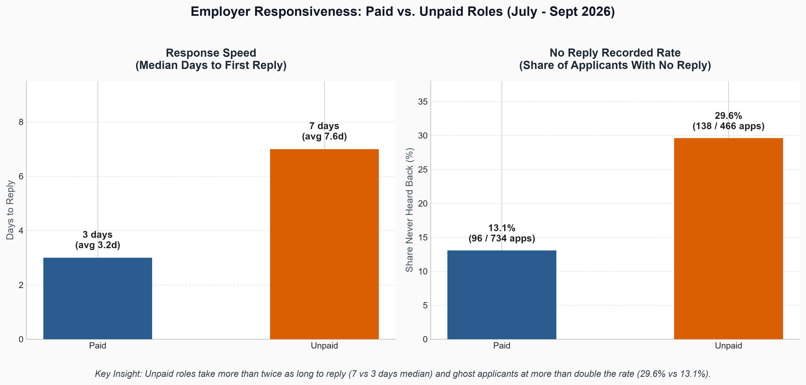

# Job Board Application Analysis (July – September 2026)

## Executive Summary & Manager's Note

> **Key Findings:**
> 1. **Source Performance:** Overall, **referrals** deliver the highest hire rate (**10.74 hires per 100 applications**), but this pattern does not hold across categories: **email** leads Software (11.36%), **college** leads Operations (20.00%), and **search** leads Data (7.41%).
> 2. **Application Completeness:** Applicants completing all 4 steps achieve a **48.39% shortlist rate** versus just **9.28%** for incomplete applications—an absolute gain of **+39.11 percentage points (5.21x more likely)**.
> 3. **Paid vs. Unpaid Disparity:** Unpaid roles respond more than twice as slowly as paid roles (**median 7 vs. 3 days; mean 7.6 vs. 3.2 days**) and ghost applicants at over double the rate (**29.61% vs. 13.08%**). This gap severely damages student retention and must be addressed.
>
> **Recommendation:**
> Next month, introduce an interactive **application progress tracker** to nudge 4-step completion, and enforce a **4-day response SLA with automated employer reminders** for unpaid postings to curb student ghosting.
>
> **Data Quality Concerns:**
> I would not trust the **Finance data** (0 hires across 101 applications despite interviews, pointing to broken conversion logging). Additionally, **6 duplicate records** and **15 untracked sources** reveal data ingestion pipeline leaks requiring validation fixes.

---

## Key Questions & Detailed Findings

### Question 1: Which source brings the most hires per 100 applications? Does the answer hold for each role category?

- **Overall Winner:** **Referral** brings the most hires per 100 applications (**10.74%**), followed by Email (**8.12%**), Search (**5.69%**), College (**3.37%**), and Social (**2.33%**).
- **Does it hold across each role category?** **No, it does not.**
  - **Software:** **Email** leads (**11.36%**), while Referral is second (**6.98%**).
  - **Operations:** **College** leads (**20.00%**), while Referral is second (**11.11%**).
  - **Data:** **Search** leads (**7.41%**), Social is second (**4.44%**), while Referral had **0 hires**.
  - **Finance:** **0 hires across all sources** (0 out of 101 applications).
  - **Design:** Referral leads (**23.08%**), followed by Search (**10.64%**).
  - **Marketing:** Referral leads (**22.22%**), followed by Email (**15.38%**).

#### Conversion Breakdown Table (Hires per 100 Applications):

| Role Category | College | Email | Referral | Search | Social | Top Channel |
| :--- | :---: | :---: | :---: | :---: | :---: | :--- |
| **Design** | 6.67% | 7.41% | **23.08%** | 10.64% | 0.00% | Referral |
| **Marketing** | 5.56% | 15.38% | **22.22%** | 3.80% | 4.08% | Referral |
| **Software** | 0.00% | **11.36%** | 6.98% | 4.79% | 0.00% | Email |
| **Operations** | **20.00%** | 0.00% | 11.11% | 5.77% | 0.00% | College |
| **Data** | 0.00% | 0.00% | 0.00% | **7.41%** | 4.44% | Search |
| **Finance** | 0.00% | 0.00% | 0.00% | 0.00% | 0.00% | None (0 hires) |
| **Overall** | **3.37%** | **8.12%** | **10.74%** | **5.69%** | **2.33%** | **Referral** |

---

### Question 2: Are applicants who finish all 4 steps shortlisted more often than those who do not? By how much?

- **Yes, significantly more often.**
- **Shortlist Rates:**
  - Completed all 4 steps: **48.39%** (195 shortlisted out of 403 applicants)
  - Completed < 4 steps: **9.28%** (74 shortlisted out of 797 applicants)
- **By how much?**
  - **Absolute Difference:** **+39.11 percentage points higher**
  - **Relative Multiplier:** **5.21x more likely** to be shortlisted

---

### Question 3: How fast do applicants hear back from paid roles compared with unpaid roles, and what share never hear back? Is the gap big enough to act on?

- **Response Speed (for applicants who received a reply):**
  - **Paid Roles:** Median **3.0 days** (Mean **3.22 days**; range 1–14 days)
  - **Unpaid Roles:** Median **7.0 days** (Mean **7.62 days**; range 1–32 days)
  - Paid roles hear back **more than 2.3x faster** than unpaid roles.
- **Ghosting Share (Never Heard Back):**
  - **Paid Roles:** **13.08%** (96 of 734 applicants)
  - **Unpaid Roles:** **29.61%** (138 of 466 applicants)
  - Unpaid applicants are **more than 2.25x as likely** to be ghosted.
- **Is the gap big enough to act on?**
  - **Yes, absolutely.** A median wait of 7 days paired with a ~30% ghosting rate on unpaid internships creates a poor candidate experience, erodes student trust in the platform, and indicates employer apathy for unpaid listings.

---

## Key Visualization

The chart below summarizes the employer responsiveness and ghosting disparity (**Question 3**):



*Figure 1: Comparison of median days to first reply and applicant ghosting rate between paid and unpaid roles.*

---

## Data Cleaning & Hygiene Audit

The raw dataset contained 1,206 rows. The following issues were audited and resolved:

1. **Duplicate Records:** Identified **6 exact duplicate records** (12 rows total sharing 6 `application_id`s with identical values across all columns). Removed duplicates using `application_id`, leaving exactly **1,200 unique applications**.
2. **Categorical Normalization (`work_mode`):** Found inconsistent casing and separators (`On-site`, `on-site`, and `on_site`). Normalized all entries to lower snake_case (`remote`, `hybrid`, `on_site`).
3. **Missing Values (`source`):** Found **15 missing values** in the `source` column. These records were tagged as `'unknown'` to preserve total application counts rather than silently dropping them. None of these 15 records resulted in a hire.
4. **Missing Values (`days_to_first_reply`):** 234 records (post-deduplication) were blank. Per data definition (*"Blank means no reply yet"*), these were identified as candidates who never heard back.
5. **Funnel Logic Validation:** Verified that no applicant was marked `hired == 'yes'` without being `interviewed == 'yes'` and `shortlisted == 'yes'`. Funnel sequence logic was intact.

---

## Project Structure & Reproducibility

```
job-board-analysis/
├── README.md                                 # Full report, answers, and manager's note
├── requirements.txt                          # Python dependencies
├── data/
│   └── job-board-applications.csv            # Original raw dataset (1,206 rows)
├── notebooks/
│   └── analysis.ipynb                        # Executable Jupyter notebook
└── outputs/
    └── question_3_paid_vs_unpaid.png         # High-resolution chart
```

### How to Re-run the Analysis

1. Clone or download this repository.
2. Install the required dependencies:
   ```bash
   pip install -r requirements.txt
   ```
3. Open and run the Jupyter notebook:
   ```bash
   jupyter notebook notebooks/analysis.ipynb
   ```
   Or execute cell by cell in VS Code / your preferred IDE. All numbers and outputs will regenerate deterministically.

---

## Tool Attribution

- **Tools Used:** Python (pandas, numpy, matplotlib, seaborn), Jupyter Notebook
---
